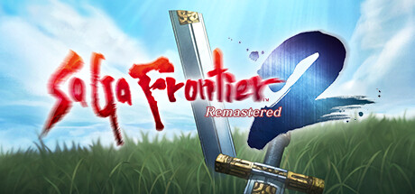

**SaGa Frontier is the non-linear RPG with eight protagonists each experiencing independent stories in a multiverse of interconnected regions. Features the unique Spark system for learning abilities by surviving enemy attacks and one of gaming's most freeform structures.**

---

## 📖 About

SaGa Frontier is the non-linear RPG with eight protagonists each experiencing independent stories in a multiverse of interconnected regions. Features the unique Spark system for learning abilities by surviving enemy attacks and one of gaming's most freeform structures.

## ⚠️ Problems Without Trainer

| Problem | Status |
|---------|--------|
| **Non-Linear Confusion** — Minimal guidance on where to go leaves many players wandering aimlessly | ✅ Solved |
| **Spark Learning RNG** — Ability learning depends on surviving specific enemy attack types | ✅ Solved |
| **Emelia Route** — Some protagonist routes are dramatically shorter and less developed than others | ✅ Solved |
| **Low Damage Early** — Character power scales slowly until Spark abilities are learned | ✅ Solved |

## ✅ Solution

The **SaGa Frontier Trainer** solves all these issues by giving you complete control over the game.

## 🎯 Full Feature List

- Unlimited Resources
- God Mode / Invincibility
- Instant Skill Cooldown
- One-Hit Kill
- Freeze Game Timer
- Unlock All Items & Achievements
- Custom Speed Multiplier
- Save State Anywhere

## 🚀 Quick Start

1. **Disable Windows Defender** temporarily (trainer may trigger false positive)
2. Download the trainer from the button above
3. Launch SaGa Frontier
4. Run the trainer as Administrator
5. Activate desired cheats with hotkeys

## 💎 Free vs Paid

| Feature | Free | Pro |
|---------|------|-----|
| Basic God Mode | ✅ | ✅ |
| Unlimited Resources | ✅ | ✅ |
| All Advanced Cheats | ❌ | ✅ |
| Auto-Updates | ❌ | ✅ |
| Priority Support | ❌ | ✅ |

## 💻 Requirements

- Windows 10/11 (64-bit)
- SaGa Frontier (any version)
- .NET Framework 4.8+
- DirectX 11+

## 🍎 macOS

macOS users can use our alternative tool:

## ⚖️ Legal

This trainer is for educational and single-player use only. Use responsibly.

---

